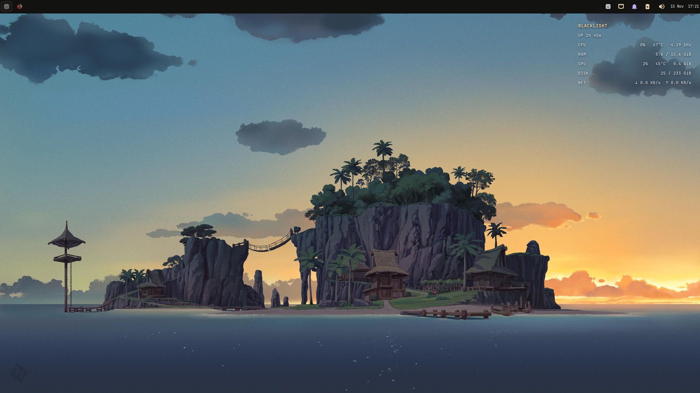
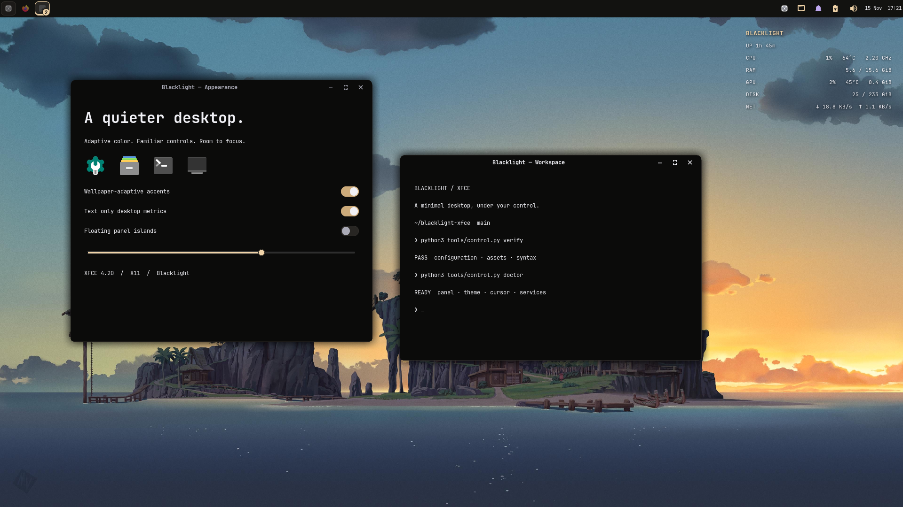
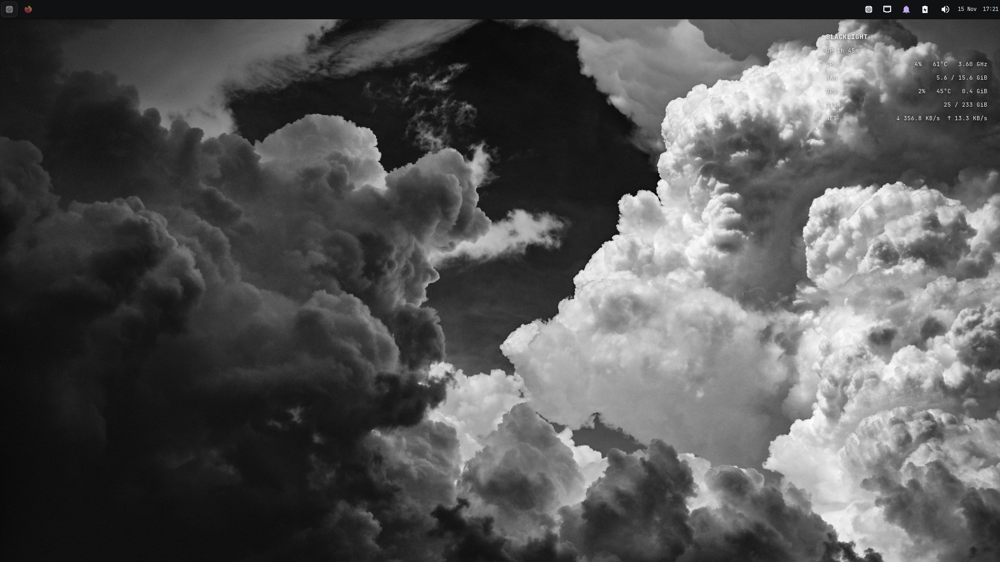

<div align="center">


**Wallpaper-adaptive XFCE customization for Ubuntu and Xubuntu.**

Galinia (gah-LEE-nyah) takes its name from the Greek phrase for “serene fire.”

[](https://xfce.org/)
[](docs/RESTORE.md)
[](docs/MAINTENANCE.md)
[](#a-foundation-for-whats-next)

[The desktop](#the-desktop) · [Reproduce it](#reproduce-it) · [Make it yours](docs/MAINTENANCE.md) · [Credits](docs/ASSETS.md)

</div>



## The desktop

Galinia keeps XFCE familiar and gives the whole workspace a consistent visual language. The panel spans the screen. Windows settle underneath it. Controls stay readable. The wallpaper supplies the accent, while the working surfaces remain dark and calm.

| Detail | What you get |
|---|---|
| **A single main bar** | Full width, always visible, app buttons on the left and system controls on the right |
| **Color that follows the wallpaper** | Event-driven palette updates across GTK, window frames, terminal and desktop metrics |
| **A coherent set of controls** | Proportional switches, sliders, radio buttons, menus and tabs |
| **Sharper details** | Papirus icons, JetBrains Mono and original chibi pointer artwork |
| **Metrics without the dashboard** | CPU, RAM, GPU, storage and network as click-through text over the wallpaper |
| **A stable foundation** | No continuous window polling, no application-icon rewriting, bounded service restart behavior |

## Room to work



The screenshots are captured from the real XFCE desktop and show its original Blacklight branding. The workspace image uses two staged demonstration windows with sample project text, not a fabricated terminal session. The hostname was temporarily replaced by the project name for the showcase; personal windows, account data and notifications are not part of the presentation.

<details>
<summary><strong>Another mood: monochrome</strong></summary>



The layout stays the same. The palette follows the wallpaper.

</details>

## Reproduce it

**Galinia is currently available as a configuration repository.** The planned installer will apply this desktop setup to an existing Xubuntu installation or to Ubuntu with XFCE. The repository contains the configuration, pinned assets and manual staging tools.

```sh
git clone https://github.com/yassincodes404/blacklight-xfce.git
cd blacklight-xfce
python3 tools/control.py verify
python3 tools/control.py doctor
```

Start with the [restoration guide](docs/RESTORE.md). You can render the configuration into an empty staging directory without changing your desktop:

```sh
python3 tools/control.py render \
  --output /tmp/blacklight-stage \
  --target-home "$HOME" \
  --monitor HDMI-0 \
  --wallpaper "$HOME/Pictures/your-wallpaper.jpg"
```

**Reference platform:** Ubuntu 26.04.1 / XFCE 4.20 / X11 / 1920×1080. Other combinations are not yet tested. The public profile bundles the exact icons, font and original pointer artwork. Wallpapers and inherited cursor roles with unverified redistribution terms are documented separately. A private owner archive preserves the complete original customization payload. See [what is exact, portable or external](docs/ASSETS.md).

## One place to keep improving it

```text
home/          portable desktop configuration and runtime scripts
assets/        pinned icon and font payloads
optional/      Firefox styling/policies and editor integration
manifests/     versions, provenance and content checksums
tools/         verify, inspect, stage and capture configuration
docs/          reproduction notes, maintenance and real screenshots
```

Edit the source, stage a change, verify it, then commit it. To bring back changes made through XFCE settings:

```sh
python3 tools/control.py capture --output /tmp/blacklight-capture
```

Capture uses an allowlist and a separate output folder. It never copies browser databases, credentials, SSH keys or the whole home directory. Read the [maintenance workflow](docs/MAINTENANCE.md) before promoting a snapshot.

## A foundation for what’s next

- [x] Central, versioned configuration
- [x] Real desktop screenshots and asset provenance
- [x] Safe staging and allowlisted configuration capture
- [x] Offline payload verification
- [ ] Clean-VM reproduction tests
- [x] Original Galinia Dusk wallpaper with editable SVG source
- [ ] An installer with dependency checks, opt-ins and rollback
- [ ] Multi-monitor and scaling profiles

The Galinia flame is available as a [standalone SVG](docs/logo.svg).

---

Built on the work of XFCE, GTK, Papirus, JetBrains Mono and the original theme authors. [Credits & licenses](docs/ASSETS.md) · [Contributing](CONTRIBUTING.md) · [Security boundaries](SECURITY.md)

## Galinia identity

The ring of fire is Galinia’s primary emblem. Galinia Dusk is supplied at 3840 × 2160 and as a scalable SVG. Use XFCE’s zoomed layout for other aspect ratios.


Original artwork and code use GPL-2.0-or-later. See [NOTICE](NOTICE) for scope. Optional LightDM styling provides rounded fields, amber focus borders and a clear login button.
